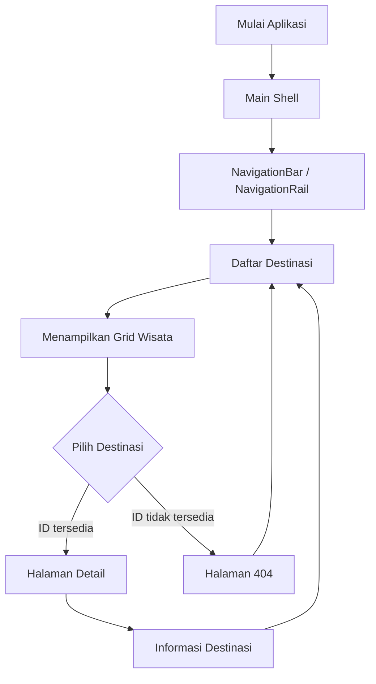
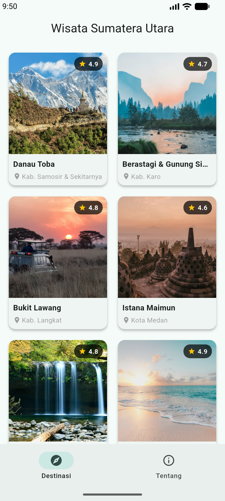
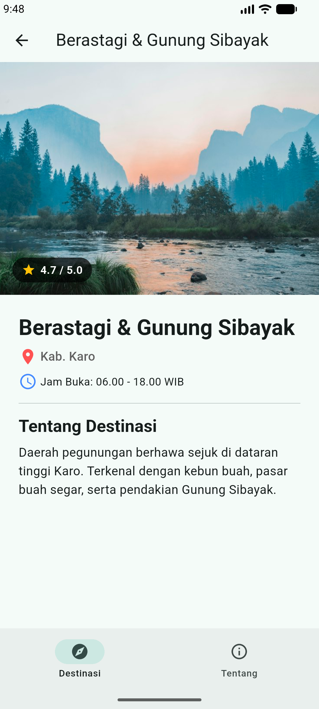
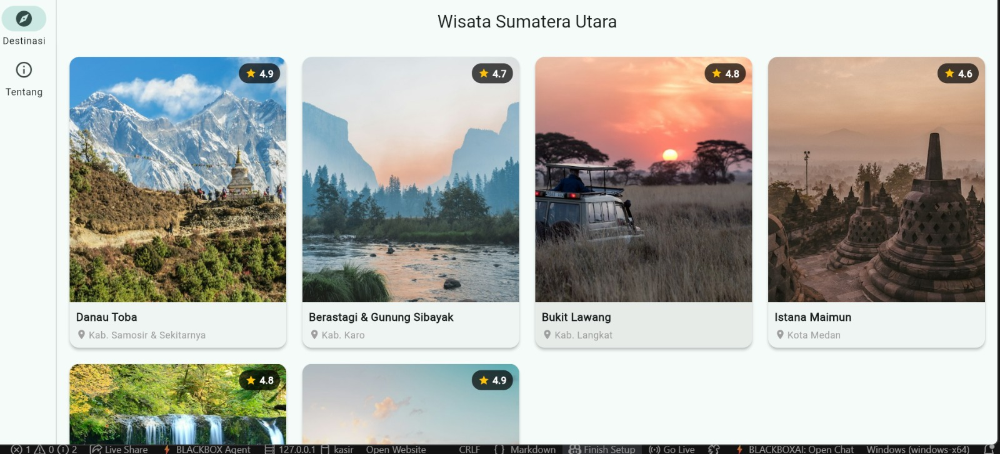

# Tugas Rutin 6: Wisata Sumatera Utara

## A. Identitas Mahasiswa

| Keterangan | Identitas |
|---|---|
| Nama | Sevta Simamora |
| NIM | 4243250019 |
| Kelas | PSIK 24C |
| Mata Kuliah | Pemrograman Mobile |
| Tugas | Tugas Rutin 6 |
| Judul Aplikasi | Wisata Sumatera Utara |

## B. Ringkasan Proyek

Wisata Sumatera Utara merupakan aplikasi katalog destinasi pariwisata yang dikembangkan menggunakan framework Flutter dan package `go_router`. Aplikasi ini menyediakan informasi mengenai berbagai tempat wisata unggulan di Sumatera Utara, seperti Danau Toba, Berastagi, Bukit Lawang, Istana Maimun, Air Terjun Sipiso-piso, dan Pulau Nias.

Aplikasi dirancang dengan konsep responsive dan adaptive layout agar dapat menyesuaikan tampilan pada berbagai ukuran layar, baik HP maupun laptop. Aplikasi memiliki halaman daftar destinasi, halaman detail destinasi, halaman 404, serta navigasi multi-tab.

## C. Struktur dan Komponen Aplikasi

| Komponen | Fungsi |
|---|---|
| Model Destinasi | Menyimpan data dan informasi tempat wisata |
| Daftar Destinasi | Menampilkan katalog wisata dalam bentuk grid |
| Detail Destinasi | Menampilkan informasi lengkap destinasi |
| App Router | Mengatur perpindahan halaman menggunakan `go_router` |
| Main Shell | Mengatur navigasi multi-tab |
| Halaman 404 | Menangani destinasi dengan ID yang tidak ditemukan |

## D. Diagram Alur Aplikasi

Diagram berikut menggambarkan alur penggunaan aplikasi Wisata Sumatera Utara.



## E. Spesifikasi dan Fitur Aplikasi

### 1. Model Destinasi dan Data Wisata

Aplikasi menggunakan kelas model `Destinasi` untuk menyimpan informasi tempat wisata dengan atribut:

- Nama destinasi.
- Kabupaten atau kota.
- Kategori wisata.
- Deskripsi.
- Harga tiket masuk.
- URL gambar (`imageUrl`).

Aplikasi menyediakan minimal enam destinasi wisata unggulan Sumatera Utara, yaitu:

1. Danau Toba.
2. Berastagi.
3. Bukit Lawang.
4. Istana Maimun.
5. Air Terjun Sipiso-piso.
6. Pulau Nias.

### 2. Halaman Daftar Destinasi dengan LayoutBuilder

Halaman daftar destinasi menggunakan `LayoutBuilder` untuk mengatur jumlah kolom grid berdasarkan lebar area tampilan.

| Ukuran Layar | Jumlah Kolom |
|---|---:|
| Ponsel (< 600 dp) | 2 kolom |
| Tablet (600–899 dp) | 3 kolom |
| Desktop (≥ 900 dp) | 4 kolom |

### 3. Halaman Detail dan Routing dengan go_router

Navigasi halaman detail menggunakan path parameter:

```text
/destinasi/:id
```

Setiap destinasi memiliki ID yang digunakan untuk menampilkan informasi sesuai pilihan pengguna. Apabila pengguna mengakses ID yang tidak terdaftar, aplikasi menampilkan halaman khusus 404 melalui `errorBuilder`.

### 4. Halaman Detail Responsif dan Widget Stack

Halaman detail menggunakan tata letak yang menyesuaikan ukuran layar:

- Layar sempit: informasi disusun secara vertikal menggunakan `Column`.
- Layar lebar: informasi disusun berdampingan menggunakan `Row`.

Widget `Stack` digunakan untuk menempatkan elemen tambahan seperti label kategori atau rating di atas gambar destinasi.

### 5. Navigasi Multi-Tab

Aplikasi menggunakan `StatefulShellRoute.indexedStack` untuk mempertahankan posisi dan status setiap tab ketika pengguna berpindah halaman.

Jenis navigasi disesuaikan menggunakan `MediaQuery`:

| Lebar Layar | Komponen Navigasi |
|---|---|
| < 840 dp | `NavigationBar` di bagian bawah |
| ≥ 840 dp | `NavigationRail` di bagian samping |

### 6. Responsive Layout dan Pencegahan Overflow

Aplikasi dirancang agar dapat digunakan pada ukuran layar 360 dp hingga 1280 dp.

Beberapa widget dan properti yang digunakan untuk mengatur tampilan antara lain:

- `Expanded` dan `Flexible` untuk mengatur ruang widget.
- `SingleChildScrollView` untuk memungkinkan konten digulir.
- `maxLines` untuk membatasi jumlah baris teks.
- `TextOverflow.ellipsis` untuk menangani teks yang terlalu panjang.

## F. Materi yang Dipelajari

Melalui pembuatan aplikasi Wisata Sumatera Utara, beberapa materi Pemrograman Mobile yang dipelajari adalah:

1. **Flutter dan Widget:** Memahami penggunaan widget untuk membangun antarmuka aplikasi.
2. **Model Data:** Membuat kelas `Destinasi` untuk menyimpan informasi setiap tempat wisata.
3. **Routing dengan go_router:** Mengatur perpindahan halaman menggunakan path parameter dan menangani halaman yang tidak ditemukan.
4. **LayoutBuilder:** Mengatur jumlah kolom grid berdasarkan ukuran area tampilan.
5. **MediaQuery:** Mendeteksi ukuran layar untuk menentukan jenis navigasi.
6. **Responsive dan Adaptive Layout:** Membuat tampilan aplikasi menyesuaikan ukuran perangkat.
7. **NavigationBar dan NavigationRail:** Menerapkan navigasi bawah untuk HP dan navigasi samping untuk laptop.
8. **StatefulShellRoute.indexedStack:** Mempertahankan status navigasi ketika pengguna berpindah tab.
9. **Stack, Row, dan Column:** Mengatur posisi dan susunan komponen pada halaman.
10. **Penanganan Overflow:** Mengatur teks dan ukuran widget agar tidak keluar dari batas layar.


## G. Dokumentasi Tangkapan Layar

Dokumentasi berikut menunjukkan hasil pengujian aplikasi pada perangkat HP dan laptop untuk membuktikan penerapan desain responsif.

### 1. Tampilan Aplikasi pada HP

Menampilkan halaman katalog destinasi dengan grid 2 kolom dan `NavigationBar` di bagian bawah layar.



### 2. Tampilan Detail Destinasi pada HP

Menampilkan halaman detail destinasi dengan susunan informasi vertikal yang menyesuaikan ukuran layar HP.



### 3. Tampilan Aplikasi pada Laptop

Menampilkan halaman katalog destinasi dengan grid 4 kolom dan `NavigationRail` di bagian samping layar.



### 4. Tampilan Detail Destinasi dan Halaman 404 pada Laptop

Menampilkan halaman detail dengan tata letak berdampingan, penggunaan widget `Stack`, serta pengujian halaman 404 ketika ID destinasi tidak ditemukan.


## H. Alasan Keputusan Desain Responsif

### 1. Pemilihan Breakpoint 600 dp dan 840 dp

Breakpoint 600 dp digunakan sebagai batas perubahan tata letak dari ponsel ke tablet. Pada ukuran di bawah 600 dp, aplikasi menggunakan grid 2 kolom. Pada ukuran 600–899 dp, aplikasi menggunakan grid 3 kolom, sedangkan ukuran 900 dp ke atas menggunakan grid 4 kolom.

Breakpoint 840 dp digunakan untuk menentukan jenis navigasi. Layar dengan lebar kurang dari 840 dp menggunakan `NavigationBar` di bagian bawah, sedangkan layar dengan lebar 840 dp atau lebih menggunakan `NavigationRail` di bagian samping.

Pemilihan breakpoint tersebut bertujuan agar tampilan aplikasi tetap nyaman digunakan dan ruang layar dapat dimanfaatkan dengan baik.

### 2. Pemisahan LayoutBuilder dan MediaQuery

`MediaQuery` digunakan pada tingkat kerangka utama aplikasi (`MainShell`) untuk mendeteksi lebar layar secara keseluruhan dan menentukan jenis navigasi yang digunakan.

Sementara itu, `LayoutBuilder` digunakan pada halaman katalog untuk mengatur jumlah kolom grid berdasarkan lebar area widget yang tersedia.

Pemisahan tersebut dilakukan agar pengaturan tampilan lebih fleksibel. Dengan demikian, perubahan ukuran layar dapat ditangani sesuai kebutuhan setiap bagian aplikasi.

### 3. Penyesuaian Tampilan HP dan Laptop

Pada HP, ruang tampilan lebih terbatas sehingga aplikasi menggunakan susunan vertikal, grid 2 kolom, dan navigasi bawah. Hal ini bertujuan agar informasi tetap mudah dibaca dan diakses.

Pada laptop, ruang tampilan lebih luas sehingga aplikasi menggunakan grid 4 kolom dan navigasi samping. Halaman detail juga dapat menampilkan gambar dan informasi secara berdampingan.

### 4. Pencegahan Overflow

Penggunaan `Expanded`, `Flexible`, `SingleChildScrollView`, `maxLines`, dan `TextOverflow.ellipsis` bertujuan untuk menghindari teks atau widget keluar dari batas layar.

Dengan pengaturan tersebut, aplikasi dapat menampilkan informasi destinasi dengan lebih rapi pada berbagai ukuran perangkat.

## I. Kesimpulan

Berdasarkan pembuatan aplikasi Wisata Sumatera Utara, saya mempelajari cara membangun aplikasi katalog pariwisata menggunakan Flutter dengan sistem navigasi `go_router`. Saya juga mempelajari penggunaan model data, LayoutBuilder, MediaQuery, NavigationBar, NavigationRail, StatefulShellRoute, dan berbagai widget untuk membuat tampilan responsif.

Melalui penerapan responsive dan adaptive layout, aplikasi dirancang agar dapat menyesuaikan tampilan pada perangkat HP maupun laptop. Selain itu, penggunaan routing dan halaman 404 membantu pengelolaan navigasi agar lebih terstruktur.

## J. Penggunaan AI

AI digunakan sebagai alat bantu dalam memahami materi serta menyusun dokumentasi README. Setiap bagian program dipelajari dan diuji kembali agar sesuai dengan spesifikasi tugas.